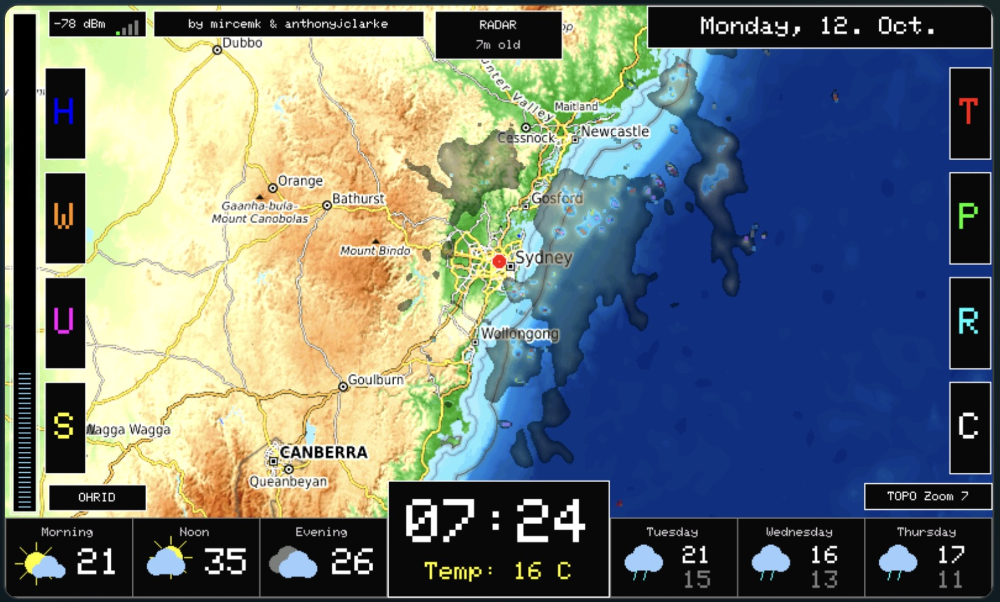
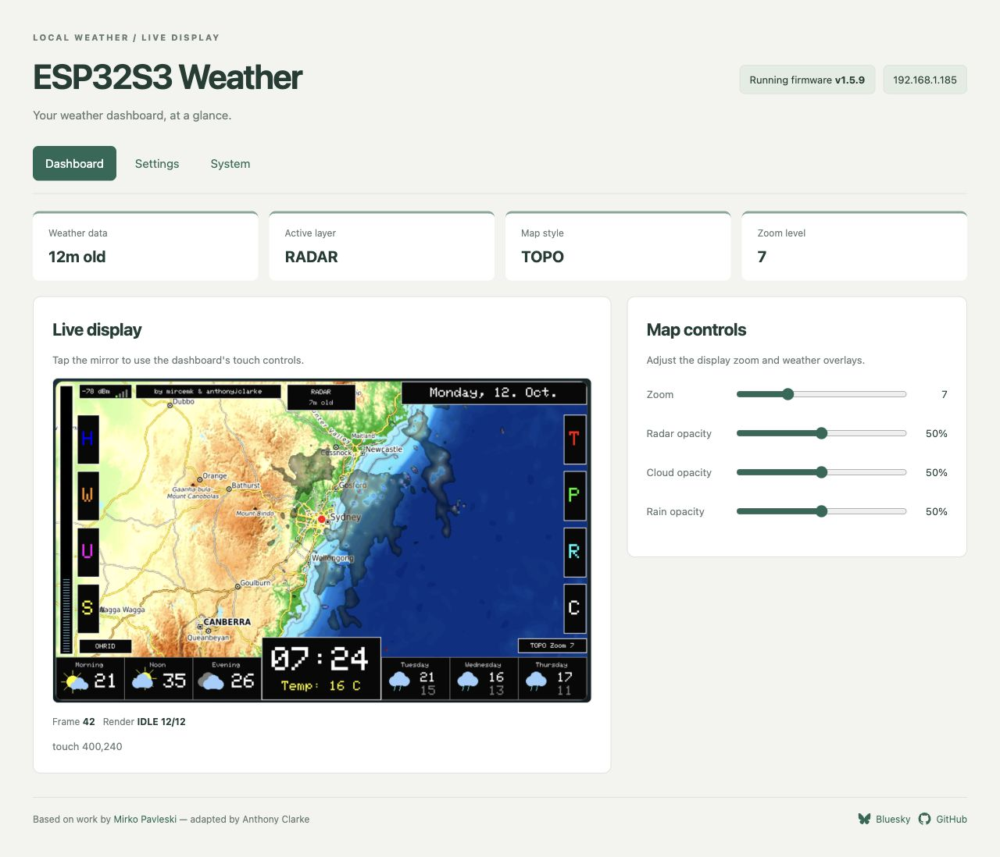

# ESP32S3 Weather

Weather dashboard for the Waveshare ESP32-S3-Touch-LCD-7 with live map tiles,
RainViewer radar, optional OpenWeatherMap cloud/rain overlays, and Open-Meteo
forecast data.

This project is based on Mirko Pavleski's (`mircemk`) Hackster project,
[ESP32 Weather Dashboard with Satellite Maps and 16-day Forecast](https://www.hackster.io/mircemk/esp32-weather-dashboard-with-satellite-maps-and-16-day-forec-7ee044) and https://www.youtube.com/watch?v=k2Vu7qecPro.
The original code and concept are by Mirko Pavleski and were adapted here for a
PlatformIO project targeting the Waveshare ESP32-S3-Touch-LCD-7 hardware stack.

## Display Example



The 7-inch TFT shows the selected map and weather overlay, current conditions,
today's forecast, and the clock. Touch controls switch layers, map styles, zoom,
and forecast graphs.

## WebUI Example



Design preview with example status data and the existing display photo. A live
board screenshot will follow hardware acceptance.

The Health App-inspired WebUI uses a paper/green palette and three sections:
**Dashboard** for the TFT mirror, data age and overlay controls; **Settings** for
device setup and night scheduling; **System** for layer caches, hardware and
reboot/WiFi actions. The running firmware version stays visible in the header.
Open `http://ESP32S3-Weather.local/` on the same network as the dashboard.

## Web Installer Preparation

Phase 3 prepares the existing [installer hub process](https://github.com/anthonyjclarke/anthonyjclarke.github.io)
for this ESP32-S3 board. Build `esp32s3-7inch-public` to exclude personal secrets,
then use `tools/package_installer.py` with the shared `cyd-web-installer` checkout.
Native USB Improv provisions WiFi; Device setup completes location/timezone and
optional OWM/OTA configuration. Public OTA starts disabled until a password is set.

The WebUI **Running firmware** label uses the same version as startup and Improv.
See [WEB_INSTALLER.md](docs/WEB_INSTALLER.md) for packaging, offsets and pending
hardware checks. A live installer and hub entry follow in Phases 4–5.

## Hardware

This build uses the Waveshare 7-inch ESP32-S3 RGB display - https://docs.waveshare.com/ESP32-S3-Touch-LCD-7

- 800x480 RGB panel
- GT911 capacitive touch
- CH422G reset/backlight expander
- PSRAM-backed map sprite
- PlatformIO / Arduino ESP32 build

## Setup

1. Configure location and map defaults in `include/config.h`.
2. Optionally configure local build credentials in `include/secrets.h`; builds
   also work without it. Device setup in the WebUI saves location, timezone,
   OWM key and OTA password to NVS and restarts to apply them.
3. Build with:

```sh
pio run
```

4. Upload with:

```sh
pio run -t upload
```

5. If no WiFi credentials are stored, connect to the `ESP32S3-Weather` captive
   portal and choose your network.

After setting an OTA password through Device setup or local build credentials,
OTA firmware uploads can use the environment below. Its `--auth` value must
match the configured password:

```sh
pio run -e esp32s3-7inch-ota -t upload
```

The OTA hostname is configured by `cfg::kOtaHostname` and defaults to
`ESP32S3-Weather.local`.

The local WebUI is always enabled after WiFi connects:

```text
http://ESP32S3-Weather.local/
```

It serves a BMP mirror of the TFT that refreshes only when the firmware updates
the display, plus layer cache status, zoom and overlay opacity controls, hardware
memory/network status, the running firmware version, reboot and WiFi reset
actions, and footer links. Clicking the mirror sends the matching TFT touch
coordinate back to the device.

## Location Settings

Set location and timezone in **Device setup** in the WebUI: search for your
town, pick it, and the coordinates and timezone fill in, with a preview of the
local time and next daylight-saving change. Saved NVS values
override build defaults. Personal build defaults remain near the top of
`include/config.h`:

```cpp
// Location settings:
// 1. Set kLocationName to the label you want to use for this dashboard.
// 2. Set latitude/longitude in decimal degrees. South is negative, east is positive.
// 3. kMapZoom controls the startup zoom. kMapZoomMin/kMapZoomMax set the touch-cycle
//    range. RainViewer radar stops at zoom 7; higher zooms show the base map.
//    OWM overlays retain the configured zoom range.
// 4. kDefaultMapStyle selects startup map base: 0 = dark, 1 = topo, 2 = OSM.
// 5. The base-map contrast/brightness values tune tile visibility on the LCD.
constexpr const char* kLocationName = "Putney, NSW, Australia";
constexpr double kLocationLatitude  = -33.8261;
constexpr double kLocationLongitude = 151.1063;
constexpr int kMapZoom    = 7;
constexpr int kMapZoomMin = 5;
constexpr int kMapZoomMax = 12;
constexpr int kDefaultMapStyle = 1;          // 0 = dark, 1 = topo, 2 = OSM
constexpr int kBaseMapContrastPercent = 125;
constexpr int kBaseMapBrightness = 18;
```

`kLocationLatitude` and `kLocationLongitude` drive both the Open-Meteo forecast
request and the map/radar center. The red location marker is drawn at the center
of the map view.

Use decimal-degree coordinates:

- Sydney / east longitudes are positive.
- Southern hemisphere latitudes are negative.
- Example: Putney, NSW is approximately `-33.8261`, `151.1063`.

After changing location settings, rebuild and upload the firmware.

## Secrets

`include/secrets.h` is gitignored. Use `include/secrets.example.h` as the
template:

```cpp
#define SECRET_WIFI_SSID ""
#define SECRET_WIFI_PASS ""
#define SECRET_OWM_API_KEY ""
#define SECRET_OTA_PASSWORD "change-me"
```

WiFi credentials are optional because WiFiManager can provision the device via
the captive portal.

`SECRET_OTA_PASSWORD` must match the `--auth` value in the
`esp32s3-7inch-ota` PlatformIO environment. Change both values before using OTA
on an untrusted network.

## OpenWeatherMap Overlays

The RADAR layer uses RainViewer and does not need an OpenWeatherMap key.

The CLOUDS and RAIN overlay buttons use OpenWeatherMap Weather Maps tiles. Set a
valid key in `include/secrets.h`:

```cpp
#define SECRET_OWM_API_KEY "your-openweathermap-key"
```

If the serial monitor shows `OpenWeatherMap overlay unauthorized (401)`, the key
is missing, not active yet, incorrect, or does not have Weather Maps access.

## API

Periodic weather refreshes and tile rendering run in a separate render task
pinned to Core 1. The Arduino main task also runs on Core 1 in this framework;
network waits yield to it, but synchronous WebUI screen streaming can still
delay touch handling. Startup weather
data is fetched once during `setup()` before the first map render. PNG tile
requests are fetched through `fetchPngToBuffer()` in `src/main.cpp`, which uses
`WiFiClientSecure` and `HTTPClient`, requests uncompressed PNG bytes with
`Accept-Encoding: identity`, applies 15 second connect/read timeouts, and
redacts API keys before logging URLs.

| API or service | What it is used for | Authentication | Where in code |
| --- | --- | --- | --- |
| Open-Meteo Forecast API | Current temperature/weather code, same-day morning/noon/evening forecast points, and 16-day daily forecast values for temperature, weather code, precipitation, humidity, wind, UV, solar radiation, pressure, and cloud cover. | None. The request uses the saved device latitude and longitude (build defaults before configuration). | `getWeatherData()` in `src/main.cpp` builds `https://api.open-meteo.com/v1/forecast?...`, downloads JSON, and fills `currentTemp`, `morningTemp`, `dMax`, `dMin`, `dRain`, `dPress`, `dCloud`, `dHum`, `dWind`, `dUV`, `dSolar`, and `dCode`. |
| RainViewer Weather Maps API | Latest radar metadata, including the tile host and newest past radar frame path. | None. | `getWeatherData()` requests `https://api.rainviewer.com/public/weather-maps.json`, then stores `radarHost`, `radarPath`, and `radarTS`. |
| RainViewer radar tiles | RADAR overlay PNG tiles shown over the selected base map. | None. | `renderRadarMap()` builds tile URLs as `radarHost + radarPath + "/256/{z}/{x}/{y}/1/1_1.png"` when `layerStyle == 0`, then decodes them with PNGdec via `pngDrawOverlayCanvas()`. |
| OpenWeatherMap Weather Maps tiles | CLOUDS and RAIN overlay PNG tiles. CLOUDS uses `clouds_new`; RAIN uses `precipitation_new`. | `SECRET_OWM_API_KEY` in `include/secrets.h`. The template is `include/secrets.example.h`. | `owmApiKey` points to the loaded device key; Device setup overrides local build defaults. `renderRadarMap()` skips OWM layers when the key is blank, builds `https://tile.openweathermap.org/map/{layer}/{z}/{x}/{y}.png?appid={key}`, and disables OWM overlays for the rest of the boot after a 401. |
| CARTO basemap tiles | Dark base map style. | None. | `mapUrls[0]` in `src/main.cpp` is `https://basemaps.cartocdn.com/dark_all/`; `renderRadarMap()` appends `{z}/{x}/{y}.png` for every visible base tile. |
| OpenTopoMap tiles | Topographic base map style. | None. | `mapUrls[1]` in `src/main.cpp` is `https://tile.opentopomap.org/`; selected by `cfg::kDefaultMapStyle = 1` or by the map-style touch control. |
| OpenStreetMap tiles | Street-map base map style. | None. | `mapUrls[2]` in `src/main.cpp` is `https://tile.openstreetmap.org/`; selected by map style index `2`. |
| WiFiManager captive portal | WiFi provisioning when no saved credentials are available. | Optional `SECRET_WIFI_SSID` and `SECRET_WIFI_PASS`; otherwise the user provisions through the `ESP32S3-Weather` access point. | `initWiFi()` in `src/main.cpp` uses `WiFiManager::autoConnect(cfg::kWifiApName)` after optionally starting `WiFi.begin()` with secrets. |
| NTP | Local clock and date display. | None. | `setup()` calls `configTzTime(cfg::kNtpTimezone, "pool.ntp.org")` after WiFi connects. `loop()` uses `getLocalTime()` for minute updates. |
| ArduinoOTA | Network firmware upload after initial serial flashing. | Saved device OTA password (or local `SECRET_OTA_PASSWORD` default), which must match the `--auth` value in the `esp32s3-7inch-ota` PlatformIO environment. | `setupOta()` in `src/main.cpp` configures hostname, password, progress/error handlers, and `ArduinoOTA.begin()`. `loop()` calls `ArduinoOTA.handle()` while WiFi is connected. |
| Local WebUI | Browser-based TFT mirror, layer cache status, immediate zoom and overlay opacity controls, hardware environment info, reboot/WiFi reset actions, and mirrored touch input on the LAN. | None; local LAN only. | `setupWebUi()` in `src/main.cpp` starts `WebServer` on port 80. `/screen.bmp` streams the LCD framebuffer as BMP, `/api/status` returns cache/render/hardware state, `/api/config` applies zoom and RADAR/CLOUDS/RAIN opacity changes (persisted to NVS), `/api/touch` maps browser clicks back to TFT coordinates, and `/api/reboot` plus `/api/reset-wifi` handle device actions. |

`cfg::kRealtimeRefreshSecs` controls how often the firmware refreshes
Open-Meteo data, RainViewer metadata, and stale rendered layer caches. Layer,
map-style, and zoom changes can also trigger tile API traffic when no valid
cache exists for the requested view.

## Realtime Refresh And Layer Cache

RADAR, CLOUDS, and RAIN are rendered into separate PSRAM layer caches. Layer
cycling uses those cached sprites instead of fetching fresh tiles on every
change.

The render path has two sprite roles:

- `renderScratch` is the background render target. Network tile fetches and PNG
  decoding happen there while the current map remains on screen.
- `cacheRadar`, `cacheClouds`, and `cacheRain` store the completed layer images.
  Once a render completes, the scratch sprite is copied into the relevant cache
  and that cached sprite becomes the front buffer for display.

The realtime refresh interval is configured in `include/config.h`:

```cpp
constexpr int kRealtimeRefreshSecs = 3600;
```

Weather data and RainViewer metadata are fetched once at startup. While awake,
the firmware schedules another fetch and an active-layer map render every 60
minutes, including while a forecast graph is selected. Layers still cycle every 30 seconds, reusing fresh
cached images. Inactive layers are rendered when selected if their caches are
missing or stale.

This changes scheduled refresh cycles from 48 to 24 per day during continuous
awake operation. Cache misses, zoom/map-style changes, and forced renders (including
opacity changes) can still trigger extra tile requests. The interval also sets
layer-cache freshness, so radar and other overlays can remain cached for an
hour. Night sleep pauses new scheduled refreshes. Failed forecast or radar
metadata requests retain the last good data and retry after five minutes; an
already running render can delay the retry. Failed tile renders retain a complete
matching cache when available and show degraded status. Without a complete
matching cache, a partial map is shown and retried on selection after five minutes.

The WebUI shows successful forecast-data age separately from refresh attempts.
No successful forecast displays an unavailable value rather than zero. Radar
metadata age measures retrieval age, not observation age. Radar requests stop
at zoom 7; higher zooms show the base map and `radar max z7`. See the
[Phase 2 review](docs/PHASE_2_REVIEW.md) for findings and hardware checks.

A serial log like this is expected during normal layer cycling:

```text
[INFO]  Layer cache hit | layer=CLOUDS age=401s | zoom=6 map=TOPO
```

It means the CLOUDS layer was already rendered for the current zoom level and
base map style, and the cached image is still inside the refresh window. In this
example the cached image is 401 seconds old, so the firmware reuses it instead
of downloading and rendering the OpenWeatherMap cloud tiles again.

A fresh cache hit avoids network/API traffic and keeps layer changes responsive.
A new render is scheduled only when the cache is missing, stale, explicitly
forced, or no longer matches the active map style or zoom.

## Notes

The Waveshare board backlight is controlled through the CH422G expander as a
digital enable. The normal brightness control is therefore steady on/off; when
`CFG_BACKLIGHT_PWM_ENABLED` is enabled, firmware software-PWMs that CH422G output
only for explicit sleep dimming.

## Reference Docs

- [Original source code](docs/weather_dashboard_original_code.c) — Mirko
  Pavleski's reference implementation, preserved for comparison.
- [Functional description](docs/weather_dashboard_functional_description.md) —
  overview of dashboard behaviour, data sources, and UI interactions.
